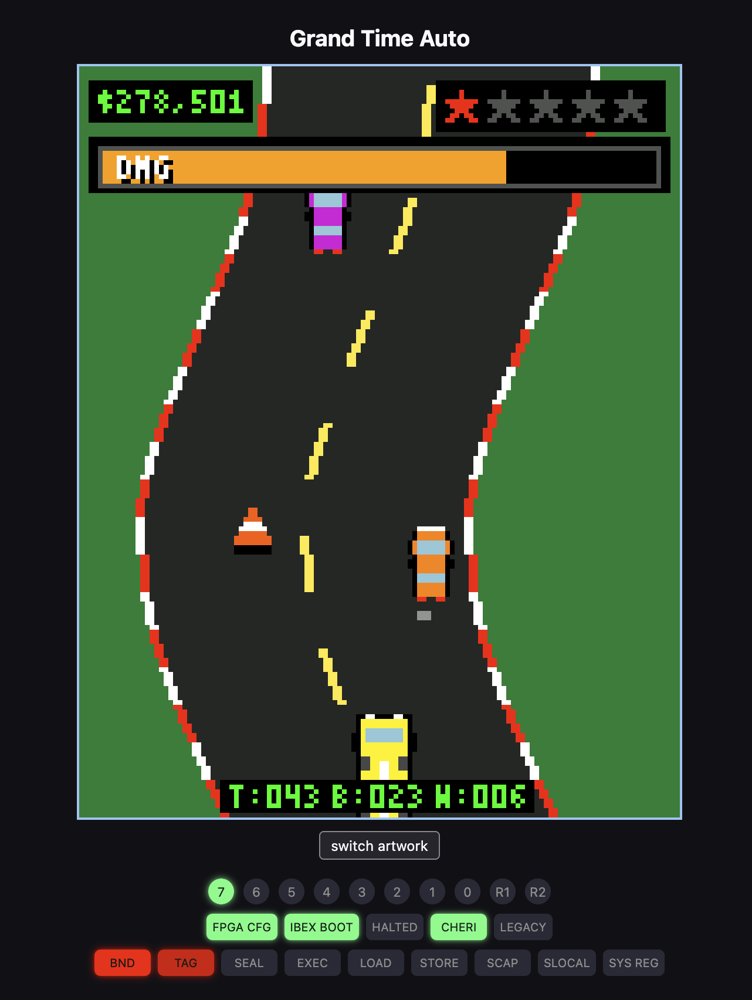

# Grand Time Auto: CHERI on Sonata

A small portrait driving game for the lowRISC Sonata v1.3 FPGA board, with a
board-free WebAssembly preview. The repository name is `gta6-cheri-sonata`.
The shared C++ game and RGB565 renderer target a **128×160** ST7735 LCD.

This README describes **version 1.1.0**, the owner-authorized release approved
on November 18, 2026. Its firmware image is attached to the
[v1.1.0 release](https://github.com/xjamesmorris/gta6-cheri-sonata/releases/tag/v1.1.0);
the [v1.0.0 release](https://github.com/xjamesmorris/gta6-cheri-sonata/releases/tag/v1.0.0)
is unchanged.
Published tags and release assets are left unchanged as project policy. That
is a maintainer commitment, not GitHub's immutable-release setting.
The browser link runs the latest separately approved Pages deployment.
Real CHERIoT protection, fault recovery, runtime artwork switching, a source
QR and emulated browser indicators are implemented. Each released firmware
image passed a physical-board startup check and reached the title screen.
These are owner-attested, image-specific startup records, not exhaustive
physical stress or interactive joystick acceptance; see
[verification boundaries](docs/architecture.md).
A browser result is **not** evidence of hardware capability enforcement.

[Source repository](https://github.com/xjamesmorris/gta6-cheri-sonata) ·
[Browser game](https://xjamesmorris.github.io/gta6-cheri-sonata/) ·
[Roadmap / TODO](docs/roadmap.md)

<a href="artwork/gta6-screenshot-01.png"></a>

Earlier web simulator capture; indicators are emulated.
[Splash screens, screenshots and video](docs/screenshots.md) include compact,
clickable image previews.

## Play

The LCD starts black, fades in the artwork over six seconds, then displays a
title menu after another three seconds. Only **Right: Play story mode** appears
in the LCD prompt. A fresh **Right** starts play. Hidden **Down** changes the
artwork during the fade-in, wallpaper hold or title prompt, once per fresh
press; holding it through a screen transition does not switch again or reset
the fade. The hidden title-menu **Left** shortcut opens a source repository
QR screen; any fresh direction/center press returns to the title, as does a
click on the QR canvas in the browser.

Use the joystick on the board, or arrow keys and Space/Enter in the browser.
Phones and narrow browser windows show a touch joystick: hold the arrows to
drive, combine directions with multiple fingers, and use **PRESS** for the
center button. Portrait and landscape layouts keep the game and controls
together; scrolling and zooming remain available outside the joystick.
The browser's artwork button is enabled only during the splash fade, wallpaper
hold and title prompt. It is disabled during play, WASTED, billing and the
source QR screen, including synthetic click events. Artwork selection survives
runs and soft resets; a power reset (or browser reload) restores the build's
initial selection. Focus loss pauses the browser and clears held input.
Cancelled touches, page hiding and resizing also release the touch controls.

- Steer through cars, trucks, buses and trailers; collect cash and gold.
- Vehicle collisions build wanted stars. Police appear from three stars,
  aim once per pass, and can explode on collisions. Police hits use normal
  damage and collision grace even at five stars; there is no instant-loss rule.
- The damage limit stays **100**. A roadside scrape or cone costs **1**,
  a barrier or traffic vehicle **3**, and a police hit **6**. Wanted-star
  progression, collision cooldowns and police scheduling are unchanged.
- Damage, escape timers, decorative roadside scenes, user LEDs and two RGB
  status LEDs share the same game state in firmware and the preview.
- Billboards vary between BUY / MORE, NO / REFUND, PAY / TOLL, STAY / COOL,
  JUST / DRIVE and GOOD / LUCK.
- An original green frog occasionally hops across the road in either direction.
  One decorative, non-colliding frog is active at a time; it does not change
  score, damage, wanted stars or wallet authority. The first crossing starts
  after about 12-20 seconds, with later appearances 20-40 seconds apart.
  Its separate seeded random stream does not change traffic generation.
- WASTED holds the colored frame and red RGB LEDs for three seconds, then
  desaturates the entire screen over six seconds while both LEDs shift toward
  purple and dim to off using the same eased fade. The monochrome frame
  remains until dismissed; billing and respawn restore normal colors.
- A fresh center press after WASTED leads to an animated **ITEMIZED REGRET**
  receipt. Left resets the
  game and balance; Right resumes with the balance after charges and a
  repaired car. Held inputs cannot skip the receipt.
- The wallet is an in-memory game score, not a financial or persistent wallet.
  There is no sound, backend service or saved progress.

Future browser audio, read-only host sound relays, native USB options and
vendor module comparisons are documented in [audio options](docs/audio-options.md).
These are researched options, **not implemented audio support**.

The HUD's `T/B/W` counters show verified tag, bounds and wallet denials.
In firmware, a separate wallet compartment owns the balance; a restricted
probe compartment performs actual forbidden accesses and recovers from
capability faults. Unexpected results stop play with **PROTECTION ERROR**,
rather than claiming a successful denial. Browser and native host tests use
an explicitly **EMULATED** backend.

See [architecture](docs/architecture.md) for compartment boundaries and the
exact audit contract, together with the retained
[CHERI gameplay plan](docs/cheri-gameplay-plan.md) and
[design review and verification record](docs/cheri-gameplay-review.md).

Development used **GitHub Copilot**, **Claude** and **GPT-6 Astra**.
The [LLM contribution policy](LLM-POLICY.md) explains disclosure, human
responsibility, publication approval and evidence requirements.
[Contributing](CONTRIBUTING.md) covers checks, licensing and provenance, and
the [security policy](SECURITY.md) says how to report a vulnerability.

## Browser and host development

The pinned Nix flake currently supports **x86_64 Linux**. Install Nix with flakes
enabled, then run:

```sh
./tools/preview
```

Open the Ethernet address printed by the tool. `--port 8001` changes the port;
`--build-only` creates static files in `build/game-preview` without a server.
The default is a unique private IPv4 address on a wired interface, excluding
Wi-Fi, bridges and loopback; `--host IPV4` is an explicit override. A missing
or ambiguous Ethernet address fails rather than falling back to loopback or
all interfaces. Allow the chosen port from your LAN in the host firewall.
Only the built preview directory is served. `--build-only` never inspects
network interfaces. Loopback is opt-in with `--host 127.0.0.1`.
The `primary` / original LCD artwork is the default.
`--artwork alternate` selects the derivative LCD artwork initially; both
remain available through the compact **switch artwork** button and hidden
splash Down input.

```sh
./tools/check-browser
```

This builds the browser preview using the locked Emscripten toolchain and runs
ASan/UBSan native tests, keyboard/touch input, cancellation, phone layouts,
focus/restart/billing checks, native/Wasm trace comparisons, LED checks and
renderer/pixel checks. Playwright uses the
pinned Chromium with its sandbox enabled. Test screenshots remain under
`build/game-preview/screenshots`.

The flake supplies Emscripten, C++, Python, Pillow, QR generation, zbar decoding,
Playwright and Chromium.
It pins Sonata software v1.3 and its dependency graph in `flake.lock`.
The scripts enter the appropriate Nix shell automatically.
Firmware and simulator shells also provide Pillow, so image conversion and
its tests do not depend on a host-system Pillow installation.

Evaluating the firmware and simulator shells makes Nix fetch inputs from that
graph. One of them, a documentation tool that the Sonata software locks to
`codeberg.org`, is not used here but must still be fetched. If that host
cannot be reached, run this once first:

```sh
./tools/prefetch-mirrored-inputs
```

It fetches the locked revision from the author's GitHub repository into the
Nix store and checks it against the content hash in `flake.lock`, so Nix
no longer needs the original host. The firmware workflow runs it too.

## Firmware build and audit

```sh
./tools/check
```

This performs a reproducible artwork check, warning-free application rebuild,
component ELF checks, the CHERIoT audit, slot-2 UF2 validation, negative policy
mutation tests, loader tests with synthetic devices, and native game tests.
It does not access hardware.

The [firmware workflow](.github/workflows/firmware.yml) runs the same
`./tools/check` and the `cheri-selftest` RTL fixture for pushes to `main` and
for pull requests. It uploads the check log, audit report, image digests and
simulator transcript as workflow artifacts, kept for 30 days. It has a
read-only token, cannot deploy or release, and never touches hardware.

The firmware target remains `gta6_wallpaper`; output is under
`build/cheriot/cheriot/release`. Only application **slot 2**
(`0x10000000`, UF2 family `0x6CE29E60`) is emitted. Other application slots
and FPGA bitstreams are not modified.

For direct builds:

```sh
nix develop --accept-flake-config
xmake f --board=sonata-1.1 --game-scene=none
xmake build gta6_wallpaper
```

Outside Nix, explicitly set `SONATA_SOFTWARE` to a compatible Sonata software
checkout containing its CHERIoT SDK and display drivers. There is no assumed
operator-specific directory layout.

## RTL simulator

```sh
./tools/sim-test wallpaper
./tools/sim-test cheri-selftest
./tools/sim-test wasted-fade
./tools/sim-test wasted-monochrome
./tools/sim-test source-qr
./tools/sim-test billboard
./tools/sim-test frog
./tools/sim-test police-survival
./tools/sim-test --all
```

Each scene builds without a UF2, runs the
Sonata RTL simulator in a private network namespace, and compares all 20,480
LCD pixels with the native renderer. Linux must permit unprivileged user and
network namespaces. The default `primary` artwork uses
`build/sim-firmware/<scene>` and `build/sim/<scene>`; explicit `alternate`
builds add `alternate/` before the scene name in both paths.
The two WASTED fixtures freeze the shared color/LED fade at its midpoint and
completed monochrome frame.
The billboard fixture shows the NO / REFUND variant; `frog` freezes a crossing
mid-hop. Both use the shared renderer and exact LCD/native comparison.
`police-survival` checks a survivable five-star police impact and a second
contact suppressed by collision grace, including the actual tag-fault count.
`source-qr` additionally decodes the rendered QR to verify the source URL.

`cheri-selftest` exercises actual tag, bounds and store-permission faults,
all road widths, repeated recovery, grant-retention and wrong-cause controls,
stack/timing budgets and continued gameplay. Its transcript checker reconciles
exact handler-verified totals and the simulator's reported fault classes.
Fixture scenes cannot be built as hardware images; the tool restores the
normal hardware build configuration afterward.

The simulator uses scripted input, not a live joystick. Physical startup fault
recovery has been checked for the recorded image, but controls, complete
interactive gameplay, electrical behavior and LCD timing still require owner
acceptance on the board.

## Credits

Thanks to lowRISC contributors for the
[Sonata example/demo suite](https://github.com/lowRISC/sonata-software/tree/v1.3/examples)
and its [CHERI Snake game](https://github.com/lowRISC/sonata-software/blob/v1.3/examples/snake/snake.cc).
The demos provide board/UI references; Snake is an earlier demonstration of
capability faults used as gameplay events. This project also builds on
[CHERIoT RTOS](https://github.com/CHERIoT-Platform/cheriot-rtos) and Sonata's
display-driver support.

Three files are adapted from lowRISC's Sonata software and stay under
**Apache-2.0** with lowRISC's copyright notice: the LCD panel driver
(`firmware/lcd_panel.cc`, `firmware/lcd_panel.hh`) and the build description
(`xmake.lua`). [Third-party notices](THIRD-PARTY-NOTICES.md) record each
parent work, its license and how it is used, including the CHERIoT RTOS,
display-driver and Emscripten code compiled into firmware and browser builds.
Upstream work keeps its original licenses; project notices do not relicense it
or imply endorsement.

## Artwork and licenses

Project code and tools are [MIT licensed](LICENSE), apart from the three
Apache-2.0 files named above. Both supplied splash images and
their generated splash data are **CC BY 4.0**, supplied and licensed by the
**Grand Time Auto project owner**:

- `primary` (default): `artwork/gta6-splash-orig-lcd.png`, 512×640 RGB.
  This is an exact 4× nearest-neighbor enlargement of a 128×160 pixel grid.
  The converter's default `native` style recovers that grid without smoothing.
- `alternate`: `artwork/gta6-splash-derivative-lcd.png`, 1024×1536 opaque RGBA.
  This is not a native-resolution LCD image. Its default `artwork` style
  center-crops to 1024×1280 (128 source rows removed at both top and bottom)
  and resizes to 128×160 with Lanczos.

The original PNG is byte-identical to the supplied file. The derivative has
only nonvisual provenance metadata removed; decoded pixels are unchanged.
Both display paths then encode little-endian RGB565 with no dithering,
replacement lettering or additional palette restriction. Optional `retro`,
`pixel-art` and `photo` styles remain available. No creator or model provenance
beyond the owner's supply and licensing statement is asserted.
[Artwork attribution and transformation details](artwork/README.md)
accompany browser and firmware build outputs, together with the code license
and third-party notices.

```sh
./tools/convert-wallpaper --preview-dir build/preview
./tools/convert-wallpaper --artwork alternate --preview-dir build/preview-alternate
./tools/convert-wallpaper --artwork primary --check
./tools/convert-wallpaper --artwork alternate --check
```

The converter generates `firmware/wallpaper_image.h` and
`firmware/wallpaper_image_alternate.h`. Build helpers accept
`--artwork primary|alternate`; direct xmake builds use `--artwork=...`.
The selection is the initial/default artwork, not a restriction against linking
both: both RGB565 bitmaps live in read-only program memory for runtime switching,
without adding a framebuffer. Custom conversion remains available:

```sh
./tools/convert-wallpaper --input path/to/your-image.png --output build/custom-image.h
```

Custom inputs are not automatically licensed by this project. `--input`
requires an explicit `--output`, so a custom image never silently replaces a
bundled header, and its file name is escaped in the generated comment.
Replacing a bundled source or generated header requires updating attribution
and tests; the default checks intentionally verify both bundled images.

## Source QR and board indicators

The hidden title QR encodes the public source repository:
`https://github.com/xjamesmorris/gta6-cheri-sonata`. It is generated locally,
not fetched from a QR service, and uses 246 packed bytes for 41 modules
including the quiet zone.

```sh
./tools/generate-source-qr --check
./tools/generate-source-qr --preview build/source-qr.png
```

The browser includes all nine CHERI fault LEDs, CHERI/Legacy and
FPGA Config/Ibex Boot/Halted indicators, all eight user LEDs and both RGB LEDs.
Bounds (0), Tag (1) and Permit Store (5) follow emulated gameplay denials;
unused fault indicators remain off. FPGA Config, Ibex Boot and CHERI model a
running target; Legacy and Halted stay off. Fault indicators retrigger and
fade over approximately 1.66 seconds using the pinned Sonata PWM timing.
This models the running board; it is **not live telemetry** and does not
replay hardware startup self-tests. See [architecture](docs/architecture.md).

## Loading a board

Read [the operator guide](docs/board-loading.md) before using `tools/load-slot2`.
Board identities and device paths **must be configured explicitly**. The loader
retains identity/topology checks, FAT-only mounts with exclusive no-follow
writes, unfinished-write guards, private approved-byte snapshots, isolated
Python, a sanitized console echo and digest-specific approval, which is
mandatory for unattended loads. No board configuration is bundled.

## GitHub Pages

The [Pages workflow](.github/workflows/pages.yml) builds and checks the same
locked browser edition. Deployment is disabled by default: it requires a
manual dispatch from `main`, an approval variable, and the `github-pages`
environment. Nothing enables Pages or creates releases automatically.

The owner approved initial publication, Pages deployment and the v1.0.0
release on November 17, 2026, and the v1.1.0 release and its Pages deployment
on November 18, 2026. Those approvals do not bypass workflow gates or
configured environment protections, and a local build is not a deployed site.
See [Pages configuration and verified action pins](docs/pages.md).
