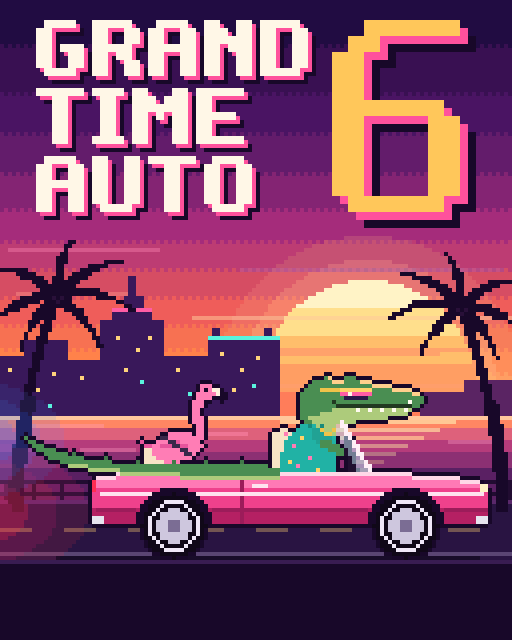
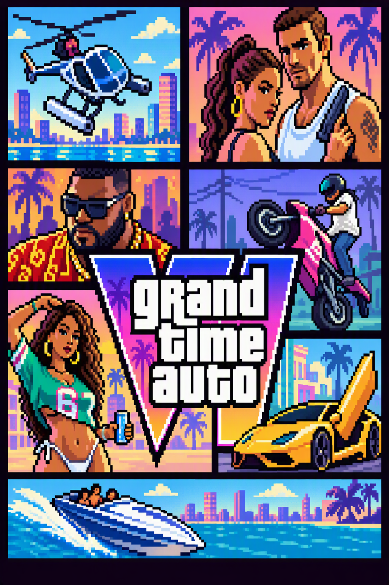
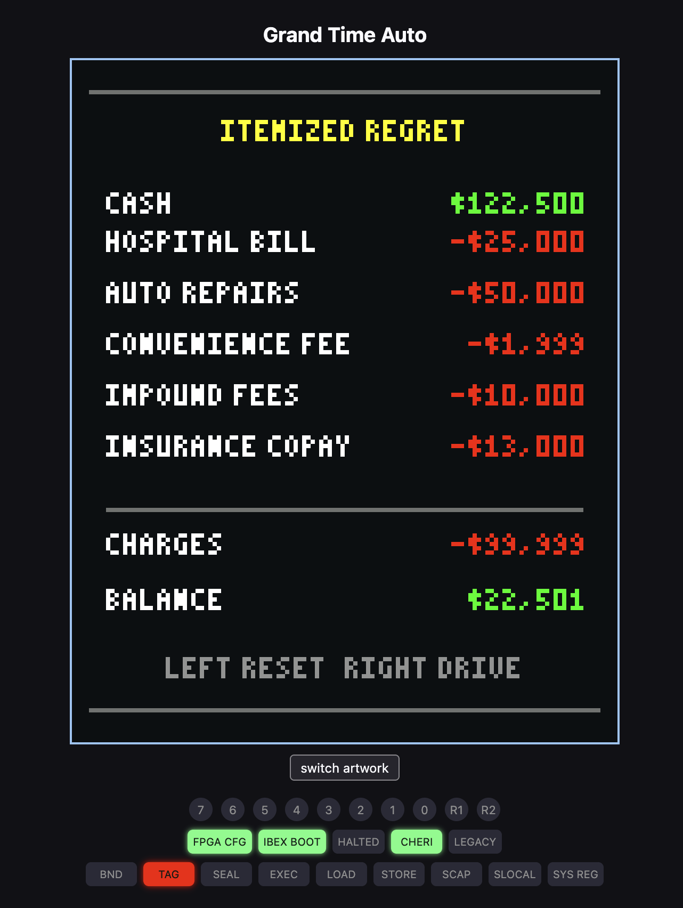

# Screenshots and video

Click a compact thumbnail to open its full-resolution image.

## Splash screens

These are the supplied splash-artwork files. The LCD renders at 128x160;
the derivative is centre-cropped and resized. See the
[artwork and conversion notes](../artwork/README.md).

### Original (default)

### Derivative

## Web simulator captures

These are owner-supplied captures of the **web simulator**, not photographs
of a physical board. The displayed CHERI and board indicators are emulated.
They predate some post-release UI changes, including artwork-button availability.

### Driving

### Itemized regret

### WASTED

## Video

[Watch the video on YouTube](https://youtu.be/Jhp5tLoUC-w).

[Back to the README](../README.md)
