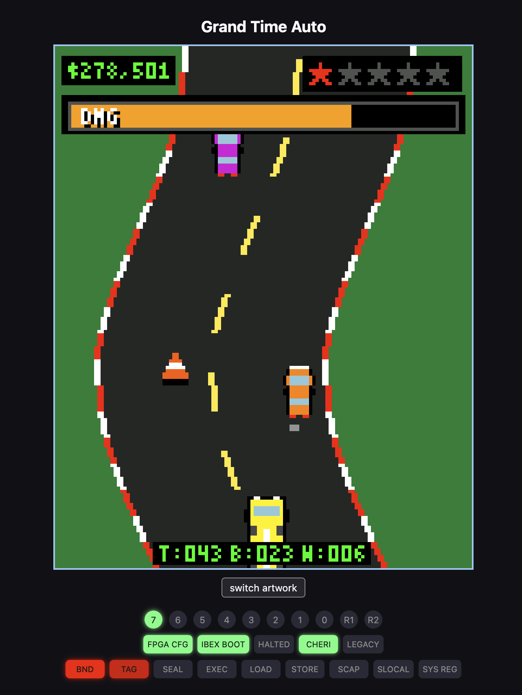
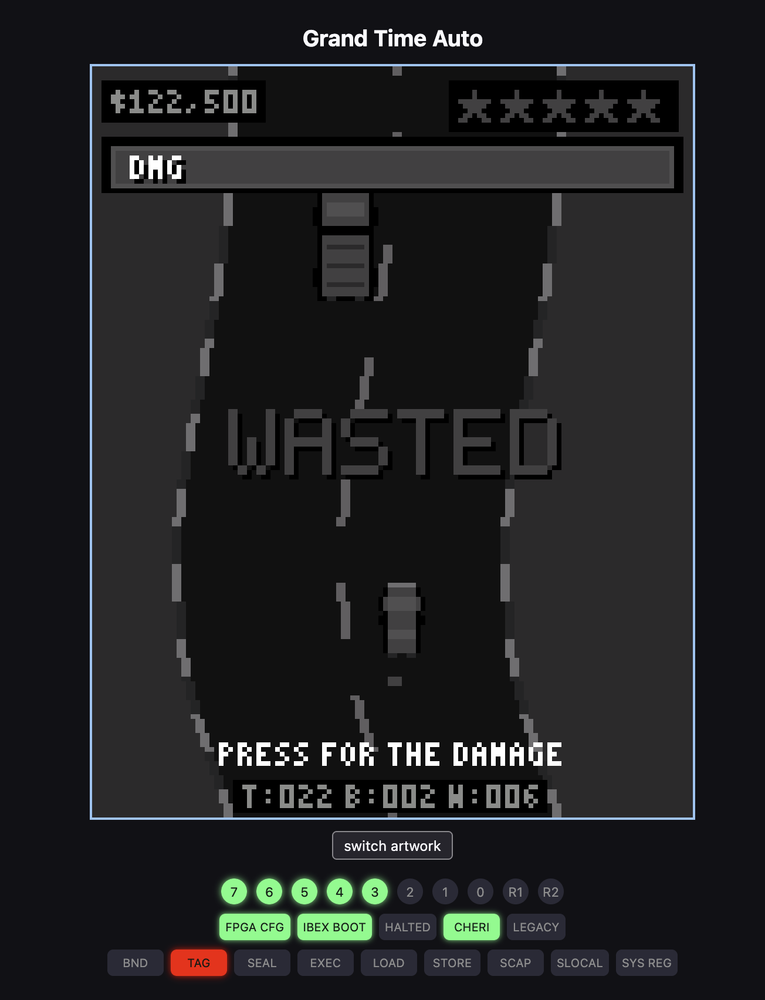

# Screenshots

These are owner-supplied captures of the **web simulator**, not photographs
of a physical board. The displayed CHERI and board indicators are emulated.
Click a compact thumbnail to open its full-resolution image.

## Driving

## Itemized regret

## WASTED

[Back to the README](../README.md)
